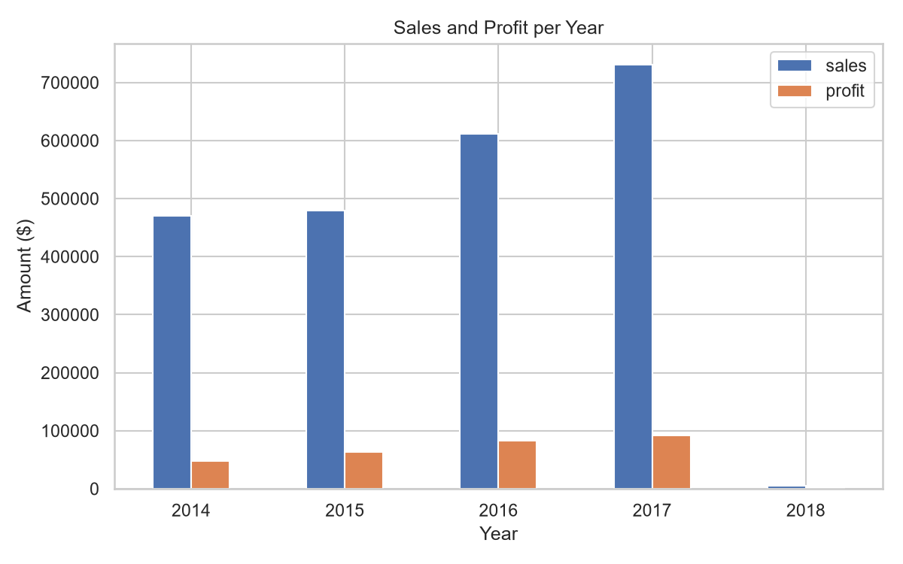
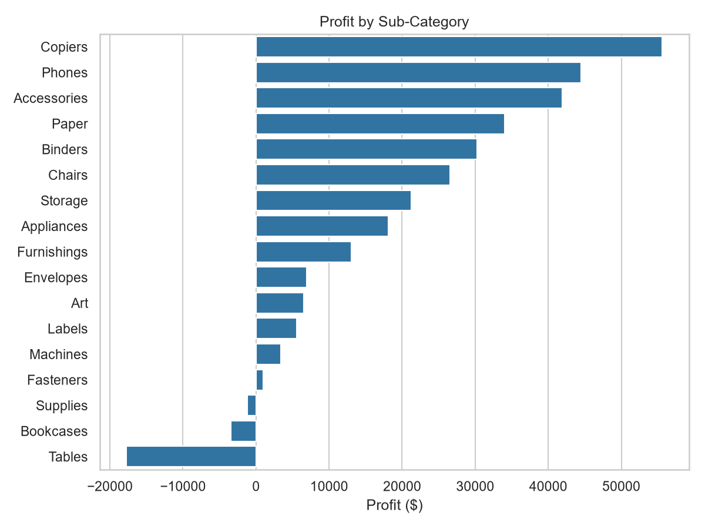
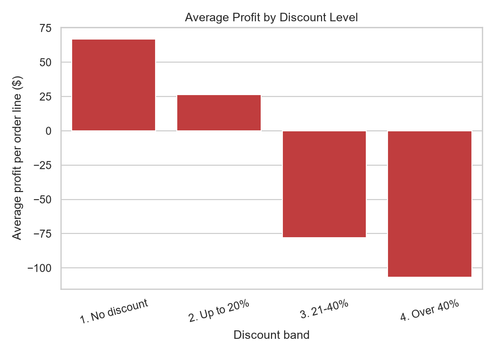

# Superstore Sales Analysis with SQL

A beginner SQL project: I loaded a retail sales dataset into a SQLite database and wrote SQL queries to answer business questions about sales, profit, discounts and customers.

## Dataset
Superstore Dataset from Kaggle ([add link]) — ~9,994 order lines with sales, profit, discount, region, category and customer info.

## Tools
SQL (SQLite), Python, pandas, matplotlib, seaborn

## Business questions
1. What are the overall sales, profit and profit margin?
2. Which categories and regions perform best?
3. Which sub-categories lose money?
4. How do discounts affect profit?
5. How have sales changed by year?
6. Who are the top customers?

## SQL concepts used
`GROUP BY`, `HAVING`, `ORDER BY`, `LIMIT`, `CASE WHEN`, date functions (`strftime`), `COUNT(DISTINCT)`, CTEs and window functions (`ROW_NUMBER`)

## Key Findings
- Total sales were $___ with a profit margin of ___%.
- ___ is the top category by sales, and ___ has the best margin.
- These sub-categories lose money: ___.
- Orders with discounts over 40% had an average profit of $___, compared to $___ with no discount.
- Sales ___ from ___ to ___.

## Project structure
- `load_data.py` — loads the CSV into a SQLite database
- `queries.sql` — all SQL queries
- `run_queries.py` — runs the queries, saves results and charts
- `results/` — query outputs as CSV

## Run it
pip install -r requirements.txt
python load_data.py
python run_queries.py

## Limitations
- Sample dataset, not real company data.
- Discount and profit are correlated here, but this analysis doesn't prove cause.